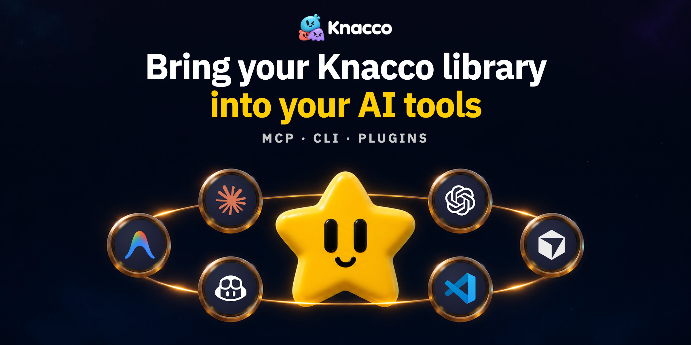

<p align="center">
  
</p>

<p align="center">
  <a href="#connect"></a>
  <a href="#connect"></a>
  <a href="#connect"></a>
  <a href="#connect"></a>
  <br>
  <a href="#connect"></a>
  <a href="#connect"></a>
  <a href="#connect"></a>
  <br>
  <a href="https://registry.modelcontextprotocol.io/v0/servers?search=com.knacco/knacco"></a>
  <a href="#your-connection"></a>
  <a href="claude/.claude-plugin/plugin.json"></a>
  <a href="LICENSE"></a>
</p>

# Knacco plugin

Bring your Knacco library into your AI tools. Connect once. Then search what you own, open a product’s guide and get your files without leaving the conversation.

<p align="center">
  
</p>

## Connect

Server URL:

```text
https://knacco.com/api/v1/agent/mcp
```

<details open>
<summary><b>Claude Code</b></summary>

```sh
claude mcp add --transport http knacco https://knacco.com/api/v1/agent/mcp
```

Or install the plugin from this repository:

```text
/plugin marketplace add byoverseas/knacco-plugins
/plugin install knacco@knacco-plugins
```
</details>

<details>
<summary><b>Codex</b></summary>

```sh
codex mcp add knacco --url https://knacco.com/api/v1/agent/mcp
codex mcp login knacco
```
</details>

<details>
<summary><b>Claude</b></summary>

Customize → Connectors → Add custom connector. Paste the server URL and sign in.
</details>

<details>
<summary><b>ChatGPT</b></summary>

In ChatGPT on the web, open Plugins, select Add, then Add custom MCP server. Name it Knacco, paste the server URL, choose Create as a plugin and sign in. Then type @Knacco in a new chat. Your ChatGPT plan or workspace must allow custom MCP servers.
</details>

<details>
<summary><b>Cursor</b></summary>

Add to `.cursor/mcp.json`:

```json
{
  "mcpServers": {
    "knacco": { "url": "https://knacco.com/api/v1/agent/mcp" }
  }
}
```
</details>

<details>
<summary><b>VS Code with GitHub Copilot</b></summary>

Add to `.vscode/mcp.json`:

```json
{
  "servers": {
    "knacco": { "type": "http", "url": "https://knacco.com/api/v1/agent/mcp" }
  }
}
```
</details>

<details>
<summary><b>Antigravity</b></summary>

Add to `~/.gemini/config/mcp_config.json`:

```json
{
  "mcpServers": {
    "knacco": { "serverUrl": "https://knacco.com/api/v1/agent/mcp" }
  }
}
```
</details>

Full guide: [knacco.com/en/help/ai-tools](https://knacco.com/en/help/ai-tools)

## Ask for what you need

```text
What is in my Knacco library?
```

A connected tool can list your library, search it, read a product’s guide and get a download link for its files that works for 30 seconds. It cannot buy anything, see payment details or change your account.

## Your connection

- You choose how long it lasts when you approve it: 30, 60 or 90 days, or no expiry.
- Disconnect at any time: Account → Billing and security → Connected AI tools → Revoke.
- Resetting or changing your password, turning off two-step verification or deleting your account also disconnects every tool.
- Knacco records when a tool connects and when it is used, with its IP address, as part of your account security records, and deletes these records after 12 months. [Privacy policy](https://knacco.com/en/policies/privacy)

## This repository

| Folder | Tool |
| --- | --- |
| `claude/` | Claude Code plugin |
| `cursor/` | Cursor plugin |
| `antigravity/` | Antigravity plugin |
| `.claude-plugin/marketplace.json` | Claude Code marketplace |
| `.cursor-plugin/marketplace.json` | Cursor marketplace |

Every plugin connects to the same server. None contains a secret.

## Licence

[MIT](LICENSE)

---

[Plugin page](https://knacco.com/en/plugin) · [Connection guide](https://knacco.com/en/help/ai-tools) · [Help](https://knacco.com/en/help) · [Privacy](https://knacco.com/en/policies/privacy)
